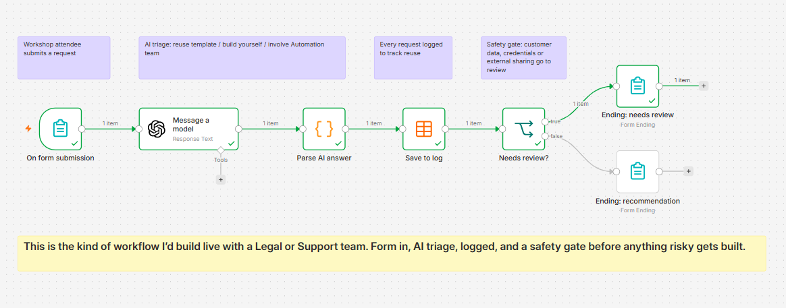

# Workshop Triage Assistant (n8n + OpenAI)

A small n8n workflow for post-workshop follow-up. After an AI or automation workshop, staff describe a task they want to automate. AI recommends one of three routes, every request is logged, and anything risky is routed to review before anyone builds it.

## What it does

1. **Form:** the attendee enters their team, the task, the tools involved and their confidence with AI tools (1-5).
2. **AI triage:** OpenAI returns JSON with a recommendation (`reuse template`, `build yourself` or `involve Automation team`), a one-line reason, risk flags and a next step.
3. **Parse:** a Code node strips code fences from the model output and parses the JSON, so later nodes get clean fields.
4. **Log:** every request is saved to an n8n Data Table, to track demand and reuse over time.
5. **Safety gate:** if the AI flags customer data, credentials, external sharing or legal/contract data, or recommends involving the Automation team, the request goes to a review path.
6. **Response:** the attendee sees either their recommendation and next step, or a note that the request will be reviewed first.

## Why I built it this way

- **Small on purpose:** it is the kind of workflow I would build live with a Legal or Customer Support team in a session.
- **Safe by default:** risky requests are reviewed before they are built, rather than after.
- **Measurable:** the log shows which requests come up again, which tells you which templates to build next.

## Try it

1. In n8n, go to **Workflows > Import from File** and select `workflow.json`.
2. Add your own OpenAI credential to the **Message a model** node.
3. Create a Data Table called `triage_log` with these text columns: `team`, `task`, `tools`, `confidence`, `recommendation`, `reason`, `risk_flags`, `next_step`, then select it in **Save to log**.
4. Click **Execute workflow** and submit the form.

## What I would add next

- Send "needs review" requests to a Slack channel for the Automation team.
- Link the recommended template directly when the answer is "reuse template".
- A four-week follow-up asking whether the automation is still in use.

Built by [Garrett Stack](https://garstack.com).
